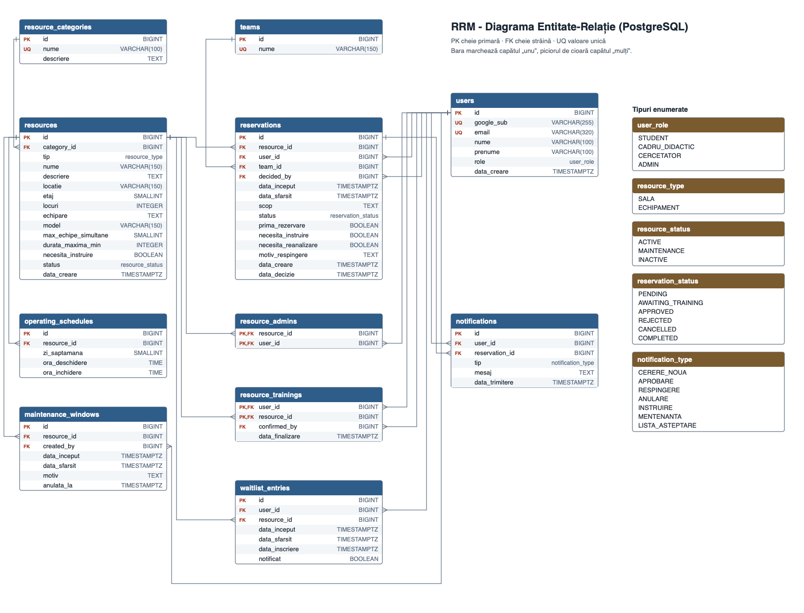

# LABORATOR 5

## 1. API REST (9.2)

API-ul respectă specificația OpenAPI 3.0 și are 25 de rute și 35 de operații, grupate după componentele din diagrama de componente: Auth, Users, Categories, Resources, Reservations, Approvals și Waitlist.

Autentificarea se face exclusiv cu Google, doar cu conturi instituționale @student.usv.ro: frontend-ul trimite ID token-ul la `POST /auth/google`, iar backend-ul răspunde cu un JWT transmis ulterior ca `Authorization: Bearer`.

## 2. Tehnologii backend (9.3)

| Componentă | Tehnologie | Motiv |
| --- | --- | --- |
| Limbaj | Python 3.12 | Limbajul framework-ului FastAPI |
| Framework | FastAPI | Recomandat în laborator; validare cu Pydantic și documentație OpenAPI generată automat |
| ORM | SQLAlchemy 2 | Recomandat în laborator pentru PostgreSQL |
| Migrări | Alembic | Instrumentul standard pentru SQLAlchemy |
| Bază de date | PostgreSQL 16 | Date puternic relaționate, tranzacții și blocări de rând pentru evitarea suprapunerilor |
| Autentificare | Google OpenID Connect, JWT | Cerință: „Sign in with Google” ca unică metodă |
| Teste | pytest | Testarea regulilor de rezervare |
| Mediu local | Docker Compose | Pornește baza de date, backend-ul și frontend-ul cu o singură comandă |

## 3. Tehnologii frontend (9.4)

| Componentă | Tehnologie | Motiv |
| --- | --- | --- |
| Limbaj | TypeScript | Tipuri verificate, utile la integrarea cu API-ul |
| Framework | Next.js (React) | Construit peste React, recomandat în laborator; rutare pe pagini și protecția paginilor pe roluri |
| Client API | Strat unic peste `fetch` | Atașarea token-ului și tratarea centralizată a erorilor 401, 403, 409, 422 |
| Proiectare UI | Figma | Prototipul din Laboratorul 4 |

## 4. Baza de date (9.6)

Am ales o bază de date **relațională (PostgreSQL)**, deoarece entitățile sunt puternic legate între ele, iar regula principală a aplicației (0 suprapuneri) cere tranzacții.

### Diferențe față de diagrama de domeniu din Laboratorul 4

| Modificare | Motiv |
| --- | --- |
| `users.email`, `google_sub`, `prenume` | Notificările pe email și autentificarea Google au nevoie de ele; prototipul separă numele de prenume |
| Tabelul `resource_admins` | Relația Resource–User este mulți-la-mulți |
| Tabelul `resource_trainings` | Instruirea finalizată se păstrează pentru perechea utilizator–resursă (R11) |
| Tabelul `teams` | Permite calcularea utilizării pe echipă (R13) |
| `reservations.necesita_reanalizare`, `decided_by`, `data_decizie` | Rezervările afectate de mentenanță și trasabilitatea deciziei |
| `resources.tip`, `etaj`, `locuri`, `echipare`, `model`, `durata_maxima_min`, `necesita_instruire` | Câmpuri afișate în prototip; R11 |
| Valoarea `INACTIVE` în `resource_status` | Dezactivarea resurselor păstrează istoricul |
| `maintenance_windows.created_by`, `anulata_la` | Mentenanța poate fi anulată înainte de expirare |

Diagrama de secvență se actualizează: la crearea cererii se numără cererile `PENDING` și `AWAITING_TRAINING`, nu doar rezervările aprobate, iar numărătoarea se face pe fiecare slot de 30 de minute.

## 5. Implementarea bazei de date (9.7)

Baza de date rulează pe PostgreSQL 16:

- `db/schema.sql`: tipuri enumerate, 11 tabele, chei, indecși și două triggere
- `db/seed.sql`: date de test preluate din prototipul Figma
- `db/tests.sql`: 12 verificări ale regulilor de business
- `docker-compose.yml`: pornește serverul și încarcă automat schema și datele

Regula „fără suprapuneri” este garantată și în baza de date: trigger-ul `reservations_capacity` blochează rândul resursei și verifică fiecare slot, astfel încât două cereri simultane nu pot depăși capacitatea.

## 6. Sarcini în Jira (9.5)

Proiectul E1 conține 10 sarcini de tip Epic și sarcinile copil aferente, fiecare cu descriere.

## 7. Utilizarea instrumentelor de inteligență artificială

Conform cerinței din Laboratorul 1.

| Instrument | Scop | Prompt | Data |
| --- | --- | --- | --- |
| Claude Code (Claude Opus 5.5) | Analiza laboratoarelor și a documentației din Confluence și Jira; identificarea pașilor pentru Laboratorul 5 | „ok i ve loaded all the labs, I want u to analyze them precisely and what we have on confluence and tell me next steps to solve lab5” | 05.11.2026 |
| Claude Code (Claude Opus 5.5) | Ciorne pentru ERD, specificația OpenAPI și scripturile bazei de date | „we want to use fastapi postgresl and nextjs” | 05.11.2026 |
| Claude Code (Claude Opus 5.5) | Redactarea acestei pagini și actualizarea sarcinilor din Jira | „go ahead” | 05.11.2026 |
| Claude Code (Claude Opus 5.5) | Inițializarea proiectelor FastAPI și Next.js, modelele SQLAlchemy și migrările Alembic | „lets o start implementing the app did u make the swagger?” | 05.11.2026 |
| Claude Code (Claude Opus 5.5) | Autentificarea Google, restricționată la conturile @student.usv.ro | „yes only student emails, also lets comit and merge all branches into one” | 05.11.2026 |
| Claude Code (Claude Opus 5.5) | Implementarea funcționalităților MVP (backend și frontend) și a testelor automate | „it works, now lets finish the app, only login is done what is left ot finish the app” | 05.11.2026 |
| Claude Code (Claude Opus 5.5) | Actualizarea acestei pagini și a stării sarcinilor din Jira | „yes to the first 2 points, 3rd is ok like now dont modify domains” | 05.11.2026 |
